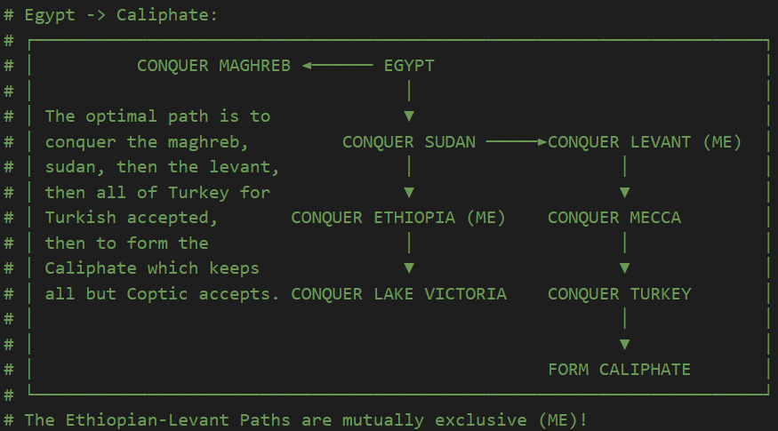

# AB-DOD-MP
Stands for "Allbored Divergences of Darkness Multiplayer"; a modification for Victoria 2 which includes decision and event adjustments. The map may change as well.

# References
Based on [Rileyo's](https://github.com/rileyo92/Divergence-Expanded-MP) multiplayer version of Divergences of Darkness.

# FAQ's
**Q:** What infamy does sanctions kick in at? 
**A:** 32.5 Infamy

# How To Install
- Download the repository into the game's "mod" folder and move the .mod file out of the mod's folder into the mod folder adjacent to the mod's directory.

# Checksum: `JZJI`

# Changed Mission Trees

## Other Changes
Burgundy
- Added decision to core Switzerland after forming Arpitania
- Increased infamy of decisions relating to Rhinish path

Scandinavia
- Increased infamy of decisions relating to North Sea Empire path

Russia
- Added decision to temporarily increase literacy gain after Empiricism is researched (similar to vanilla Russia)

Ottomans
- Increased infamy of decisions relating to all paths
- Added decision to temporarily increase literacy gain after Empiricism is researched (so you permanently behind)
- Added very cool decision for the Turkish navy

Spain
- Added decision to colonize Western Sahara early (also available to Iberia)
- Added decisions to puppet and annex Taungu (also available to Iberia)

Aragon
- Increased infamy of decisions relating to Aragon-Italy path
- Added decision to core southern Spain and northern Morocco up to Gibraltar

Savoy
- Added decision to gain cores on Milan immediately (free cb + benefits of cores) at the cost of more infamy than justification

Italy
- Increased infamy of decisions relating to Adriatic and Latin paths (does not affect Venice Adriatic path)
- Added decision to burn Carthage

Egypt
- Added decisions to change Aswan and Wad Madani to iron and coal respectively
- Added decision to gain extra research points at the start of game for 8 years to help with westernization, at the cost of militancy (only if unciv)

Macedonia
- Removed Turkish and Kurdish accepted pops, replaced with assimilation modifier on Turkey
- Increased infamy for decisions in the Egyptian and Indian paths
- Added very cool decision for the Macedonian navy

Hungary
- Increased and Decreased infamy for decisions in the Balkan path
- You can now bring harmony to the Balkans and everybody will live happily ever after

Japan
- Increased infamy for decisions in the China path
- Changed how Japan gets cores in China

Zhorou
- Added immigration decision
- Added decision to colonize some pacific islands early
- Added decision to change Kojonup to iron

Ethiopia
- Added decision to Mare Nostrum the Red Sea
- Added decision to invite missionaries for increase research point gain (only if unciv)

Batavia
- Added decision for cores on Mozambique
- Added decision for cores on Madagascar
- Added immigration decision

Jerusalem
- Added decision to change Jerusalem to precious goods
